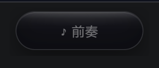

# Lyric Island · Windows 歌词灵动岛

对标 [Lyricod-App](https://github.com/Indarkdust/Lyricod-App) 的 Lyricod Island 和
[Lyricify Lite](https://github.com/WXRIW/Lyricify-App) 的 Dynamic Lyrics Island，
用 **Tauri 2 + Rust + 原生 TS/JS** 实现的 Windows 桌面歌词灵动岛。

当前版本是**可运行的 MVP**：SMTC 媒体会话 → LRCLIB 歌词 → 逐字高亮 → 宽度自适应漂浮胶囊。

---

## 1. 技术栈选型：为什么是 Tauri 2 而不是 WinUI 3

三条路线都认真评估过，最终选 Tauri 2。

| 维度 | WinUI 3 + C# | WPF + C# | **Tauri 2 + Rust** |
| --- | --- | --- | --- |
| 动画上限 | Composition API，弹簧动画最顺滑 | Storyboard，能凑但生硬 | CSS transition/cubic-bezier，够用且好调 |
| 点击穿透 | `SetWindowLong` 互操作 | 同左，成熟 | 内置 `setIgnoreCursorEvents`，一行 |
| 宽度自适应 | 隐藏控件 `Measure(PositiveInfinity)` | 同左 | Canvas `measureText` / 隐藏节点 `offsetWidth` |
| 逐字高亮 | XAML 富文本 + 逐字动画，重 | Run 拼装，较重 | **DOM span + class 切换，最轻** |
| 打包体积 | ~60–90 MB（自包含） | ~40 MB + 运行时 | **~4 MB exe / ~2 MB 安装包** |
| 本机就绪度 | 要装 .NET 10 SDK + Windows App SDK | 要装 .NET SDK | **Rust 1.99 + VS BuildTools 已就绪** |
| 玻璃效果 | Mica/Acrylic 原生 API | 需 P/Invoke | 需 `window-vibrancy`，或纯 CSS 模拟 |

**决定性因素**：Lyricod 用的是 WinUI 3 + .NET 10，那套 `WindowsAppSDKSelfContained` +
`PublishTrimmed` 的 unpackaged 部署在非管理员环境里坑很深；而这台机器上 Rust 工具链
是现成的、NSIS 打包链路刚验证过。走 Tauri 可以当天跑起来，WinUI 3 还要先解决 SDK 安装。

**WinUI 3 更好的地方**（如果以后要换）：
- Composition 的 `CreateSpringVector3Animation` 真正能做到 Q 弹，CSS 只能近似；
- 真实的 Mica/Acrylic 合成，不需要拿 CSS 假装玻璃；
- 和系统主题、DPI、字体渲染的结合更自然。

**结论**：MVP 和日常使用选 Tauri；如果要追求"极致手感 + 原生玻璃"，可以只把窗口层
用 WinUI 3 重写，歌词/Provider 逻辑照样移植。

---

## 2. 项目结构

```
lyric-island/
├── index.html                      # 灵动岛的唯一页面
├── package.json / vite.config.js
├── src/
│   ├── main.js                     # 入口：窗口、时钟、事件编排
│   ├── island.js                   # 渲染层：DOM + 宽度自适应 + 逐字推进
│   ├── style.css                   # 液态玻璃质感 + 展开/淡出动画
│   └── lyrics/
│       └── lrc.js                  # LRC 解析 + 逐字时间轴生成 + 二分查找
├── src-tauri/
│   ├── Cargo.toml
│   ├── tauri.conf.json             # 窗口：透明、无边框、置顶、不抢焦点
│   ├── capabilities/default.json   # 最小权限集
│   └── src/
│       ├── main.rs
│       ├── lib.rs                  # 窗口定位 + 命令注册
│       ├── smtc.rs                 # SMTC 会话监听（500ms 轮询 + 事件推送）
│       └── lyrics.rs               # LRCLIB 请求（精确匹配 → 模糊搜索）
└── scripts/                        # 开发用：CDP 调试脚本
    ├── cdp-eval.mjs
    ├── cdp-shot.mjs
    └── cdp-logs.mjs
```

> 这三个 CDP 脚本不是运行时依赖，是调试工具：起 Tauri 时设
> `WEBVIEW2_ADDITIONAL_BROWSER_ARGUMENTS=--remote-debugging-port=9222`，
> 就能从命令行读到 WebView 里的真实 DOM 状态、截内部渲染图、收控制台日志。
> Windows 上 Tauri 没有开箱的 devtools 快捷键时，这套比盲猜快得多。

---

## 3. 核心模块

### 3.1 SMTC 监听（`src-tauri/src/smtc.rs`）

用 `Windows.Media.Control.GlobalSystemMediaTransportControlsSessionManager`。
**刻意用 500ms 轮询而不是纯事件订阅**：

- 事件要给每个 session 单独注册 `TypedEventHandler`，切歌/切播放器/播放器退出时
  还得逐个解绑，漏一个就是泄漏或野回调；
- 轮询只读 4 个属性（MediaProperties / PlaybackInfo / TimelineProperties / Thumbnail），
  开销可以忽略，且天然处理"切歌、换播放器、会话消失"。

每次循环读：`SourceAppUserModelId`、`Title/Artist/AlbumTitle`、`PlaybackStatus`、
`StartTime/Position/EndTime`（TimeSpan，100ns 单位 → 除 10000 得 ms）、`Thumbnail`（转 base64）。

推送做了三级去重，否则每 500ms 会把封面 base64 全量重发：

1. 去重 key 里挖掉 `last_updated_ms`（采样时刻，永远不同）和 `position_ms`（播放中一直在变）；
2. 封面没变就把 `artwork` 置空，前端保留旧图；
3. 内容完全没变时，每 2.5 秒补一次**心跳**——防止"启动瞬间那帧"在前端注册监听之前发出，
   导致岛上一片空白直到下次切歌。

前端启动时还会主动 `invoke('now_playing')` 拉一次，双重保险。

#### 3.1.1 播放器兼容层（v0.2 新增）

第一版有三个真实问题，都在这一层解决：

**① 酷狗有歌名没进度。** 酷狗接入了 SMTC，但 `TimelineProperties.EndTime` 恒为 0、
`Position` 纹丝不动（Lyricify 的兼容性表里写作 *No timeline*）。检测逻辑：

```rust
// src-tauri/src/smtc.rs
fn update_timeline(app_id: &str, pos: f64, end: f64, playing: bool) -> bool {
    if end > 1000.0 { return true; }              // 自报了总时长，可信
    if !playing { return w.ok; }                   // 暂停时位置本来就不动，别改结论
    if (pos - w.last_pos).abs() > 50.0 { w.ok = true; }        // 位置在推进
    else if w.moved_at.elapsed() > 2500ms { w.ok = false; }    // 播放中 2.5 秒没动 → 没时间轴
    w.ok
}
```

结论随每帧的 `hasTimeline` 字段推给前端，前端据此换时钟策略（见 3.2）。

**② 视频会话会来抢位。** 两个来源：
- `MediaProperties.PlaybackType` 能区分 `Music` / `Video`（需 `windows` crate 的 `Media` feature）；
- 但 **B 站客户端谎报 `music`**，只能靠 AUMID 排除 + 标题启发式降权。

```rust
if m.playback_type == "video" && !cfg.allow_video { return None; }
if m.artist.is_empty() && m.title.chars().count() > 30 { s -= 60; }  // 长标题且无歌手
```

**③ 多会话不知道该跟谁。** 旧的 `GetCurrentSession()` 只会返回"系统认为当前"的那个，
实测就出现过「B 站在播视频 → 返回 B站 → 酷狗的歌根本不显示」。改成枚举 + 打分：

| 条件 | 分值 |
|---|---|
| `PlaybackStatus == Playing` | +100 |
| 有时间轴 | +30 |
| 有艺术家 | +10 |
| 是系统当前会话 | +50 |
| 标题 >30 字且无艺术家（网页视频特征） | −60 |

排除列表命中或 `PlaybackType == video`（且未开 `allowVideo`）的会话直接出局。

**④ 窗口标题兜底。** SMTC 完全给不出音乐会话时，用 Win32 `EnumWindows` 找指定进程的窗口
（`src-tauri/src/wininfo.rs`，带进程名和窗口类名），正则提取歌名。
实测酷狗标题是**跑马灯滚动字幕**：

```
 - Into You - 酷狗音乐 Ariana Grande     ← 滚到中段
u - 酷狗音乐 Ariana Grande - Into Yo     ← 滚到边界，正则匹配不上
```

所以解析失败时沿用 30 秒内上一次成功的结果，避免歌词闪回"暂无歌词"。

**诊断面板（Ctrl+Shift+D）** 把这一切摊开：每个会话的 AUMID / PlaybackType / 有无时间轴 /
歌名歌手，所有疑似播放器的窗口标题和进程名，以及可实时修改的正则与排除项。
排查"为什么这个播放器没被识别"只靠它。

### 3.2 时间插值（`src/main.js` 的 `clock`）

SMTC 的 position 是 500ms 一次的快照，直接用会一顿一顿。做法：

```js
sync(posMs, playing) { this.pos = posMs; this.at = performance.now(); this.playing = playing; }
now() { return this.playing ? this.pos + (performance.now() - this.at) : this.pos; }
```

两次快照之间线性外推，每来一个新快照重新对齐，漂移不累积。

**无时间轴的会话不能这样同步。** 酷狗的 position 恒为 0，如果每 500ms 都
`sync(0, true)`，等于每半秒把估算进度打回开头 —— 歌词会一直卡在第一句、
而且一帧一帧地重复高亮。正确做法是只在"切歌"和"播放/暂停切换"时对表：

```js
function applyClock(np, trackChanged) {
  if (np.hasTimeline) { clock.sync(np.positionMs, np.playing); return; }
  const restart = trackChanged || prevPlaying !== np.playing;
  if (restart) clock.sync(np.positionMs || 0, np.playing);
  else clock.playing = np.playing;   // 其余时候让 performance.now() 自己累加
}
```

这条分支撑起了整个"酷狗能用"的体验。副作用是手动拖进度条后歌词不会立刻跟上，
要等切歌或暂停再播，控制台会打一行提示。

### 3.3 歌词获取（`src-tauri/src/lyrics.rs`）

Rust 只负责"拿原文"，**解析全在 JS**：

- LRC 的时间戳格式太烂（`[mm:ss]` / `[mm:ss.xx]` / 一行挂多个时间戳），JS 正则处理更快；
- 逐字模拟、翻译对齐、时间偏移都在渲染层，解析结果直接就是渲染层的数据结构；
- 以后加网易云 / QQ 音乐只要多一个 provider，前端不用动。

请求顺序：`/api/get`（带 album + duration 精确匹配）→ 失败退 `/api/search`（模糊搜索，
优先带 `syncedLyrics` 的、其次时长最接近的）→ 再退只用标题搜一次（有些播放器 artist 是脏的）。

### 3.4 LRC 解析与逐字时间轴（`src/lyrics/lrc.js`）

`parseLrc()` 处理后得到 `[{ time, end, text }]`，`buildCharTimeline()` 把每行拆成
`[{ ch, t0, t1 }]`。

**最容易做错的地方是行结束时间**。不能用 `nextLine.time - line.time`：
一句唱完往往有 2–6 秒间奏，按那个区间均分，每个字会"爬"得极慢，高亮永远追不上。所以：

```js
natural = clamp(字数 * 190, 900, 12000)   // 按字数估一个合理演唱时长
if (gap <= natural * 1.05) return nextStart - 90   // 连唱：贴着下一行
return start + max(900, natural)                   // 有间奏：按自然时长收尾
```

单字的权重：中文 1、英文 0.55、空格 0.2、标点 0.7，标点后再加 0.55 的停顿权重，
这样 `，` `。` 之后高亮会自然停一下，不会匀速得像机器人。

查当前行用二分（歌词几百行、每帧都要查，线性扫太浪费）。

---

## 4. 关键难点

### 4.1 高 DPI 下窗口尺寸对不上（踩了很久的坑）

`tauri.conf.json` 里写 `width: 420`，在 200% 缩放的屏幕上实测窗口只有 **420 物理像素**，
而 WebView 按 `devicePixelRatio = 2` 渲染了 840 的内容 —— 结果只显示左上四分之一，
胶囊被裁到屏幕右边，看起来像"窗口没内容"。

现象极具误导性：`IsWindowVisible = true`、`PrintWindow` 能画出内容、CDP 截图完全正常，
只有屏幕上看不到。

修法：在 `lib.rs` 的 setup 里显式再设一次

```rust
let _ = win.set_size(tauri::LogicalSize::new(420.0, 64.0));
```

另外前端 `setSize` 的注释也写了：尺寸交给 JS 算，**位置交给 Rust 算** ——
`@tauri-apps/api` 2.1.x 的 `Window` 上没有 `currentMonitor()`（会抛
`tauriWin.currentMonitor is not a function`），而 Rust 侧的 `current_monitor()` 一直稳定。

### 4.2 宽度自适应

`#measure` 是一个 `position: fixed; top: -9999px` 的隐藏节点，用和歌词完全相同的
字体尺寸量 `offsetWidth`，加上内边距就是岛体目标宽度，再同步给窗口：

```js
const content = Math.max(w1, Math.min(w2, 420)) + 36 + 6;
const extra = this.expanded ? 236 : 0;   // 展开时给迷你播放器腾地方
this.resizeWindow(w, h);                 // → setSize(LogicalSize) + invoke('recenter_island')
```

两个细节：
- **不能用 `requestAnimationFrame` 调度 resize**：窗口在后台/被遮挡时 rAF 会被节流到
  1fps 甚至暂停，尺寸变化要等半秒才生效。改用 `setTimeout(16)`。
- 展开动画过程中反复测量会让窗口抖动，所以等 CSS 过渡走完（280ms）再定最终尺寸。

### 4.3 逐字高亮

每个字一个 `<span class="ch">`，三态：未唱（暗）、已唱（`.sung` 白）、正在唱（`.active` 主色 + 光晕）。

每帧只改动**变化的那个字**，不全量遍历：

```js
if (active !== this.lastActiveChar) {
  // 上一个字降级为 sung，中间跳过的字（拖动进度条）直接补 sung，新字升为 active
}
```

封面主色提取（OKLCH / K-means）还没接，现在高亮色是固定的 `--accent: #7aa2ff`，
接的时候只要改 `document.documentElement.style.setProperty('--accent', color)` 一处。

### 4.4 玻璃效果降级

**WebView2 的透明窗口看不到桌面内容**，`backdrop-filter: blur()` 只会糊自己，
得不到真正的毛玻璃。所以现在用的是纯 CSS 假玻璃：半透明深底 + 内描边 + 顶部高光渐变
（`#island::before`）+ 淡径向折射（`#island::after`）。观感够，成本为零。

要真玻璃有两条路：
1. 加 `window-vibrancy`，`apply_acrylic(&window, Some((18,18,24,125)))` —— Win10/11 可用，
   但 acrylic + 透明窗口在 22H2 之后有"全黑"的已知问题，需要按系统版本分档；
2. 只做 Win11 的 `Mica`，Win10 直接退回现在的 CSS 方案。

代码里保留 `transparent: true`，接的时候在 `lib.rs` 的 setup 里加一行即可，前端不用改。

### 4.5 点击穿透（还没接）

`capabilities/default.json` 已经把 `core:window:allow-set-ignore-cursor-events` 打开了，
接线只需要：

```js
await getCurrentWindow().setIgnoreCursorEvents(true);   // 锁定态：完全穿透
```

现在的原型是"永远可交互"（因为要用悬停展开迷你播放器）。桌面歌词窗口那种
"锁定即穿透、解锁可拖拽"的模态，应该做成托盘里的一个开关。

---

## 5. MVP 范围与后续路线

### 这一版已经做了

- [x] SMTC 会话读取（标题 / 艺术家 / 专辑 / 封面 / 播放态 / 进度）
- [x] 多会话枚举（`list_sessions`，能拿到 Edge、B站客户端等同时在线）
- [x] LRCLIB 歌词（精确匹配 → 模糊搜索 → 标题兜底）
- [x] LRC 解析 + 逐字时间轴生成 + 二分定位
- [x] 灵动岛窗口：透明、无边框、置顶、不抢焦点、跳过任务栏
- [x] 宽度随歌词自适应 + 顶部居中
- [x] 逐字高亮（主色 + 光晕）
- [x] 下一行预览
- [x] 悬停展开迷你播放器（封面 / 歌名 / 上一首 / 播放暂停 / 下一首）
- [x] 暂停淡出、无会话时降到 28% 透明度
- [x] 底部进度条（展开态）
- [x] 播放控制回传给 SMTC

### 下一批（按性价比排序）

1. **托盘 + 全局快捷键**：没有托盘就没法退出（窗口没有关闭按钮，只能任务管理器）。
2. **设置持久化**：窗口位置、歌词源优先级、时间偏移、排除列表、快捷键、主题色。
3. **桌面歌词窗口**：`label: "desktop-lyrics"` 的第二个窗口，锁定态
   `setIgnoreCursorEvents(true)`，解锁态 `startDragging()`。
4. **完整歌词窗口**：整首滚动 + 点击 seek（`invoke('seek_to', {ms})` → SMTC `TryChangePlaybackPositionAsync`）。
5. **封面取色**：Rust 侧用 `image` crate 做 K-means，或者前端 canvas `getImageData` + OKLCH 转换。
6. **逐字歌词源**：接 QQ 音乐 QRC（有加密，`QrcDecrypter` 那套）和网易云 YRC。
7. **歌词时间偏移**：按歌记忆 `offset`，存本地。

### 已知限制

- **手动指定跟随哪个播放器要靠"跟随"按钮（v0.2 已做）**，但它只影响本进程的选择逻辑，
  不会把系统当前会话抢过来 —— 真要抢需要 `TrySetActive()`（Win11 22H2+），
  `windows` crate 0.61 还没生成这个绑定。
- **无时间轴播放器的进度是估算的**：拖进度条后歌词不会立刻跟上，要等切歌或暂停再播。
- **酷狗窗口标题是滚动字幕**：正则提取只能作为兜底，30 秒内的成功结果会被缓存沿用。
- **翻译 / 音译**：LRCLIB 不提供，要接网易云或 QQ 的歌词接口才有。
- **浮动模式**：`floating` 标志和双击切换已经埋好，但拖拽还没接（`startDragging`）。

### v0.2 配置项

配置通过 `set_config` 命令下发，目前活在内存里（重启回到默认值，阶段三接持久化）：

| 配置 | 默认值 | 说明 |
|---|---|---|
| `followApp` | `null` | 手动指定跟随的 AUMID；`null` = 自动打分选优 |
| `excludeApps` | `["msedge","chrome","firefox","potplayer","vlc","mpc-hc"]` | AUMID 子串匹配，不区分大小写 |
| `allowVideo` | `false` | 允许 `PlaybackType == video` 的会话 |
| `windowFallback` | `true` | SMTC 无音乐会话时退回窗口标题 |
| `windowProcess` | `"kugou.exe"` | 回退时只看这个进程的窗口 |
| `windowRegex` | `^\s*-\s*(?P<title>.+?)\s+-\s+酷狗音乐\s*(?P<artist>.*)$` | 实测酷狗标题格式 |

---

## 6. 运行

```bash
# 依赖（Node 26 / Rust 1.99 / VS BuildTools 2022 已就绪）
npm install

# 开发：Vite 5174 + Tauri 窗口
npm run app:dev

# 只调页面（浏览器里跑，会自动进入演示模式，塞一首假歌词）
npm run dev        # 打开 http://localhost:5174

# 打包
npm run app:build  # 产物在 src-tauri/target/release/bundle/nsis/
```

### 调试技巧

```bash
# 1. 带 remote debugging 启动
$env:WEBVIEW2_ADDITIONAL_BROWSER_ARGUMENTS = "--remote-debugging-port=9222"

# 2. 读页面状态 / 截内部渲染 / 收控制台
node scripts/cdp-eval.mjs "document.querySelector('.line-text').textContent"
node scripts/cdp-shot.mjs out.png
node scripts/cdp-logs.mjs 6000
```

页面里还留了两个调试入口：

```js
__demo()      // 进入演示模式，忽略真实 SMTC 推送，看渲染效果
__demoOff()   // 退出演示模式
__view.setExpanded(true)   // 手动展开/收起
```

---

## 7. 权限说明

`capabilities/default.json` 只开了用到的最小集合：

- `core:window:allow-set-size` / `allow-set-position` —— 宽度自适应和居中
- `core:window:allow-set-ignore-cursor-events` —— 点击穿透（预留给锁定态）
- `core:window:allow-start-dragging` —— 浮动模式拖拽（预留）
- 没有文件系统、没有 shell、没有网络白名单（歌词请求在 Rust 侧用 reqwest 直连 LRCLIB）

网络只有两处：LRCLIB 的 `/api/get` 和 `/api/search`，都是公开只读接口，不带任何凭证。

---

## 8. 阶段三：从"能跑"到"能日常用"

这一轮修两个真实暴露的异常路径，再补系统集成。

### 8.1 歌词失败要分类，不能一句"获取失败"

**问题**：之前所有失败都收敛成一个 `Err(String)`，前端只能显示"歌词获取失败"。但用户真正需要区分的是**"这个源没有"**和**"真的出错了"** —— 前者换首歌就好，后者要去查网络。

**改法**：`lyrics.rs` 重写成 provider 架构。

```rust
pub enum LyricsErrorKind {
    NotFound,      // 404 或命中但歌词为空
    NetworkError,  // 超时 / DNS / 连接被重置
    ParseError,    // 拿回内容但不是预期 JSON
    RateLimited,   // 429
    BadRequest,    // 歌名为空之类的本地问题
    AllFailed,     // 多源汇总
}

pub trait LyricsProvider: Send + Sync {
    fn name(&self) -> &'static str;
    fn priority(&self) -> i32;
    fn search(&self, q: &LyricsQuery) -> Result<bool, LyricsFailure>;
    fn fetch(&self, q: &LyricsQuery) -> Result<(LyricsPayload, u16), (LyricsFailure, u16)>;
}
```

几个刻意的设计：

- **返回 `LyricsResponse { ok, payload, failure }` 而不是 `Result::Err`**。用 `Err` 的话 Tauri 只会把字符串扔给 `catch`，HTTP 码和错误类型就丢了，诊断面板没法显示"HTTP 429"。
- **provider 是同步的**，整个 `fetch` 跑在 `spawn_blocking` 里。这样不用 `async-trait`，阶段二加网易云 / QQ 时直接 `impl LyricsProvider` 即可。
- **`LAST_STATUS` 全局留痕**：最近一次请求的源 / HTTP 码 / 行数 / 错误细节，诊断面板一条命令就读到。

UI 文案按 `failure.kind` 分开：

| kind | 文案 |
|---|---|
| `notFound` | LRCLIB 未收录这首 · 换源或稍后重试 |
| `networkError` | 网络请求失败 · 检查网络后重试 |
| `parseError` | 歌词解析失败 · 打开诊断查看详情 |
| `rateLimited` | 被 LRCLIB 限流 · 稍后再试 |

**失败不清空已有歌词** —— 切到一首没歌词的歌，屏幕上应该停在上一次的歌词，而不是闪成空白。

### 8.2 封面"先出现后消失"的真正原因不是 CSP

一开始怀疑是 `img-src` 没放行，实际上是**竞态**：SMTC 的缩略图经常晚一两帧才到，而 `island.js` 里的旧逻辑是

```js
// 旧：artwork 为空就立刻清空
} else {
  this.coverEl.removeAttribute('src');
  this.coverEl.classList.remove('loaded');
}
```

于是每帧里"有图 → 空 → 有图"来回跳，看起来就是闪没。

**改法**：记住上次的图，空值不覆盖。

```js
if (artwork && artwork !== this._coverSrc) {
  this._coverSrc = artwork;
  this.coverEl.src = artwork;
  this.coverEl.classList.add('loaded');
}
// artwork 为空时什么都不做，保留上一张
```

只有 `setIdle()`（确实没有播放器了）才真正清空。

CSP 也顺手补全了（虽然这次不是它的问题）：

```
img-src 'self' data: blob: asset: http://asset.localhost https:;
```

### 8.3 托盘是唯一入口

岛体是 `skip_taskbar: true` 的透明窗口，**没有关闭按钮**。在加托盘之前，想关掉它只能去任务管理器结束进程。

`tray.rs` 的菜单：

```
[✓] 显示灵动岛
────────────
当前跟随：kugou.exe · Into You
  跟随指定播放器 ▸  自动选择 / 各会话
────────────
歌词偏移：+0 ms
  调整歌词偏移 ▸  提前 500 / 提前 100 / 归零 / 延后 100 / 延后 500
────────────
设置…
退出
```

实现上有两个坑：

1. **Tauri 没有"菜单即将打开"事件**，动态子菜单（会话列表）只能靠**每次整个重建菜单**。所以 `refresh()` 每 2 秒跑一次（跟着 SMTC 的 `tick % 4` 走）。开销可忽略，换来的是菜单永远显示当前真实状态。
2. **左键单击要自己接管**。`TrayIconBuilder::show_menu_on_left_click(false)` 关掉默认行为，然后在 `on_tray_icon_event` 里匹配 `TrayIconEvent::Click { button: MouseButton::Left, button_state: MouseButtonState::Up, .. }` 来切换显隐。

`CloseRequested` 统一 `prevent_close()` + `hide()`，退出只走托盘菜单里的「退出」（`app.exit(0)`）。设置窗口也走同一条路 —— 关掉只是隐藏，下次点「设置…」直接显示，不用重建。

**第一次关窗口会提示一次**（只一次，之后不再打扰）：

- 主路径是**岛体内联提示** —— 让岛体自己盖一层「已最小化到托盘，右键托盘图标可退出」，显示 2.4 秒后再隐藏窗口。走这条路而不是只发系统通知，是因为 toast 在未打包 / 无 AppUserModelID 的环境里经常静默失败，用户什么都看不到。
- 附加一条系统通知（`tauri-plugin-notification`），能弹就弹，`show()` 失败直接吞掉，不影响主路径。
- 是否弹过记在 `settings.trayHintShown`，跨进程持久化。
- 为什么不在隐藏后弹：窗口 `hide()` 之后前端不再渲染，内联提示必须在隐藏**之前**显示。所以这里用延迟隐藏（`std::thread::spawn` + `sleep(2500ms)` + `hide()`）。

### 8.4 设置的权威在 Rust，不在前端

`settings.rs` 持有全部 11 个字段，落盘用 `tauri-plugin-store`（JSON，在 `app_config_dir`）。

三条硬规则：

1. **首次加载失败必须用默认值继续**。第一次运行文件根本不存在，`unwrap()` 会直接崩在启动阶段。
2. **每次修改立刻 `save()`**。这个应用经常被任务管理器直接杀，等退出时保存等于不保存。
3. **外部状态以系统为准**。开机自启在启动时用 `autolaunch().is_enabled()` 回读覆盖 store —— 用户可能去「任务管理器 → 启动」里手动禁用过，不回读的话设置页会显示"开着"但实际没生效。

| 配置 | 默认值 | 说明 |
|---|---|---|
| `followApp` | `null` | 手动指定 AUMID，null = 自动打分 |
| `excludeApps` | `["msedge","chrome","firefox","potplayer","vlc","mpc-hc"]` | 子串匹配，不区分大小写 |
| `allowVideo` | `false` | 允许视频会话 |
| `windowFallback` | `true` | SMTC 无会话时退回窗口标题 |
| `windowProcess` | `"kugou.exe"` | 回退时只看这个进程 |
| `windowRegex` | 酷狗跑马灯正则 | 窗口标题提取 |
| `lyricOffsetMs` | `0` | 全局歌词偏移 |
| `perAppOffset` | `{}` | 按应用覆盖，如 `{"kugou":300}` |
| `islandVisible` | `true` | 启动时是否显示 |
| `launchAtStartup` | `false` | 开机自启 |
| `shortcutsEnabled` | `false` | 全局快捷键总开关 |

### 8.5 开机自启的链路必须是单向的

```
设置页开关 → 命令 set_autostart(enabled)
              → tauri-plugin-autostart enable()/disable()
              → is_enabled() 回读真实值
              → 写入 settings + 广播
```

**不让前端直接调插件**：那样 store 和系统状态会分叉，下次启动读到的是"store 说开了、系统里没开"。插件调用失败时也要把 store 回滚到系统实际值，不能留个不一致状态。

注册插件时带 `Some(vec!["--autostart"])`，以后要做"自启时不抢焦点、不弹面板"就有现成的判断依据。

### 8.6 快捷键默认关闭

全局快捷键会抢占别的软件，装完就生效是流氓行为。`shortcutsEnabled: false` 是 opt-in 总开关：关掉立刻 `unregister_all()`，打开立刻按当前键位注册，都不用重启。

| 快捷键 | 作用 |
|---|---|
| `Ctrl+Shift+L` | 切换灵动岛显示 / 隐藏 |
| `Ctrl+Shift+→` | 歌词延后 200ms |
| `Ctrl+Shift+←` | 歌词提前 200ms |

注册失败（被别的软件占用）**不 panic**，把失败项收集进 `ShortcutReport.failed` 返回给设置页，界面上明说"Ctrl+Shift+L 已被占用"。

### 8.7 歌词偏移的三层优先级

```
perAppOffset[currentAppId]  >  lyricOffsetMs  >  0
```

前端每帧用的是 `clock.now() + effectiveOffset()`。托盘和快捷键只改全局偏移；按应用偏移（比如给酷狗单独 +300ms 校漂移）在设置窗口的「歌词」区改。

Rust 侧有 `get_effective_offset(app_id)` 做同样的事，两边保持一致。

### 8.8 设置窗口

独立 `label: "settings"`，复用同一个 `index.html`，靠 `?window=settings` 分流到 `settings-window.js`。

不和岛体共用窗口的原因：岛体是透明置顶的异形窗口，宽度自适应那套逻辑会被设置面板的尺寸搅乱，而且透明背景下的表单很难看。

四个分区：**通用**（自启 / 快捷键 / 语言占位）、**歌词**（全局偏移 / 按应用偏移 / 源优先级占位）、**跟随**（followApp / 排除列表 / allowVideo / 窗口回退三件套 + 测试正则）、**诊断**（歌词状态 + 会话列表 + 窗口列表）。

配置变更用 `emitTo` 双向同步：设置页改完 → Rust 落盘 → `emit_to("island", "settings:changed")` → 岛体立即生效，不用重启。

### 8.9 这一轮踩到的系统级坑

`cargo build` 在某个时刻开始全线失败：

```
error: failed to run custom build command for `lyric-island v0.1.0`
Caused by: could not execute process ...\build-script-build (never executed)
Caused by: 应用程序控制策略已阻止此文件。 (os error 4551)
```

事件日志 `Microsoft-Windows-CodeIntegrity/Operational` 里是：

```
Code Integrity determined that a process (cargo.exe) attempted to load
...build-script-build.exe that did not meet the Enterprise signing level
requirements or violated code integrity policy (Policy ID:{0283ac0f-...})
```

`{0283ac0f-fff1-49ae-ada1-8a933130cad6}` 是 **Smart App Control 的 ISG 策略**。SAC 在 enforced 状态下会拦截**所有未签名的新可执行文件**，Rust 的 build script 首当其冲 —— 换 target 目录也没用，连 `typeid`、`serde_core` 的 build script 都被拦。

处置：`HKLM\SYSTEM\CurrentControlSet\Control\CI\Policy\VerifiedAndReputablePolicyState` 从 `1` 改成 `0`，**重启后生效**。

注意 SAC 关闭在微软的设计里是单向的（重启后除非重装/重置系统没法再打开）。如果只是临时编译，重启前把值改回 `1` 就放弃了。

同理，**SAC 开启时这个应用的新版本连运行都会被拦**，不只是编译。

---

## 9. 阶段三验证清单

编译通过后按这个顺序验：

1. **歌词分类**
   找一首冷门歌（LRCLIB 一定没有）→ 岛体显示「LRCLIB 未收录这首 · 换源或稍后重试」；
   断网再切歌 → 显示「网络请求失败 · 检查网络后重试」。
   打开诊断面板（`Ctrl+Shift+D`）看「歌词状态」区块：应能看到源 `lrclib`、HTTP 码、行数或错误类型。

2. **封面不再闪没**
   连续切五首歌，观察悬停展开态的封面：应该"上一张 → 直接换成新的一张"，中间不出现空白。

3. **托盘**
   右键托盘图标：菜单里「当前跟随」应实时跟着播放变化；
   点「跟随指定播放器 → 某个 App」→ 岛体立刻只跟那个会话；
   左键点托盘图标 → 岛体显示/隐藏切换；
   点「退出」→ 进程真的结束（任务管理器里消失）。

4. **关闭拦截**
   设置窗口点 × → 窗口消失但进程还在；再点托盘「设置…」→ 窗口重新出现，且配置还在。

5. **持久化**
   在设置里把酷狗正则改坏（比如删掉一个括号）→ 保存 → 托盘退出 → 重新启动 → 打开设置，坏掉的正则还在（说明存下来了，不是每次重置成默认）。

6. **开机自启**
   打开开关 → `Win+R` 输入 `shell:startup` 看不到东西（Tauri 用的是注册表 Run 键，不是启动文件夹）；
   更可靠的验证：`Get-ItemProperty "HKCU:\Software\Microsoft\Windows\CurrentVersion\Run"` 里应有 `lyric-island` 项。
   关掉开关后该项消失。

7. **快捷键**
   打开快捷键总开关 → 按 `Ctrl+Shift+L` 岛体消失/出现；
   按 `Ctrl+Shift+→` 两次 → 托盘菜单里「歌词偏移」变成 `+400 ms`；
   如果某个键被占用，设置页会显示"已被占用"。

8. **偏移优先级**
   设置里给当前 App 配 `perAppOffset = 300`，全局偏移设 0 →
   歌词应比之前晚 300ms；把全局改成 -300 而 perApp 仍是 300 → 偏移不变（perApp 优先）。

### 9.1 实测结果（2026-11-04，Windows 11 26H2 26300.9711 / 200% 缩放）

| 项 | 结论 | 备注 |
| --- | --- | --- |
| 歌词 NotFound | 通过 | `kind="notFound"`，`detail="/search 返回 0 条（http=200）"` |
| 歌词 NetworkError | 通过（实测 503） | 当时 LRCLIB 自身返回 503，正好撞上，`kind="networkError"`、`httpStatus=503` |
| 诊断面板歌词状态 | 通过 | track / source / httpStatus / lineCount / kind / elapsedMs 均在 |
| 封面不闪没 | 通过（脚本模拟） | A → 空 artwork → B：空 artwork 时保留 A，未清空 |
| 托盘图标存在 | 通过 | Win11 在**溢出面板**里，不在常驻区 |
| 托盘 tooltip | 通过 | `Lyric Island ...Baby One More Time (Remastered) - Britney Spears` |
| 托盘右键菜单 | 通过 | 显示灵动岛(✓) / 当前跟随 kugou / 跟随指定播放器 / 歌词偏移 +0ms / 调整歌词偏移 / 设置… / 退出 |
| 左键切显隐 | 通过 | `debug_toggle_island` 走的同一条 `apply_island_visible`，true→false→true |
| 开机自启 | 通过 | `HKCU\...\Run` 出现 `lyric-island.exe --autostart`，关掉后消失 |
| 偏移优先级 | 通过 | perApp `kugou=300` + 全局 `-300` → kugou 得 300，其他得 -300 |
| 快捷键注册 | 通过 | 开启后 `Ctrl+Shift+L / → / ←` 三个全部 registered，关闭后清空 |
| 设置持久化 | 通过 | 改 windowRegex + excludeApps → 重启 → `[settings] 已从 settings.json 载入`，值原样保留 |

### 9.2 release 实测（2026-11-04，安装版）

装的是 `Lyric Island_0.1.0_x64-setup.exe`，currentUser 静默安装到
`%LOCALAPPDATA%\Lyric Island\`，启动的是安装目录里的 `lyric-island.exe`。

| 项 | 结论 | 备注 |
| --- | --- | --- |
| 托盘 tooltip | 通过 | `Lyric Island No Good - UNSECRET` |
| 左键切显隐 | 通过 | 真实鼠标点托盘图标，`debug_island_visible` 变 false |
| 托盘右键菜单 | 通过（修完才通过） | 见下面「release 才暴露的 bug」 |
| 关窗口不退进程 | 通过 | 发 `WM_CLOSE` 后进程仍在 |
| 托盘「退出」 | 通过 | 点完进程消失 |
| 连续切歌封面不空白 | 通过（真歌） | 采样 75 秒，`Don't Laugh I'll Cry` → `Strawberry` 切换瞬间 `cover-img.src` 始终非空，长度 24926 → 29126 直接换图 |
| 开机自启 | 通过 | 注册表写的是 **`C:\Users\21787\AppData\Local\Lyric Island\lyric-island.exe --autostart`**，不是 debug 路径 |
| 设置持久化 | 通过 | 改 windowRegex / excludeApps / perAppOffset → 重启 → 全部保留，`get_effective_offset('kugou')` = 444（perApp 优先） |

**release 才暴露的 bug：托盘右键菜单点不出来**

dev 下偶尔能弹，release 下稳定不弹。原因不是 UIA 或 `mouse_event`——是
`tray::refresh()` **每 2 秒无条件重建整个菜单**。用户按下右键到菜单弹出之间
如果正好撞上一次 `set_menu()`，Windows 就没法把这次点击转发给旧菜单，表现为
"右键毫无反应"。

修法：给菜单内容算一个签名（followApp / offset / visible / 当前曲目 / 会话列表），
只有签名变化才重建，tooltip 仍然每次都更新。改完 release 重打包，右键稳定可用。

**没验到的**：
- 设置窗口的交互没逐个点（按应用偏移的增删行、测试正则按钮），只确认了窗口能开、字段能存。
- 副屏 / 混合 DPI 场景：本机是**单屏**（AMD Radeon 780M，3072×1920 物理 / 1536×960 逻辑，200% 缩放），没有第二块屏可测。
- 快捷键的真实按键（只验了注册状态，没在别的窗口前台时按 `Ctrl+Shift+L`）。

### 9.3 关闭提示实测（2026-11-04，dev）

| 步骤 | 结果 |
| --- | --- |
| 第一次关窗口 | `data-hint="true"`、提示文本「已最小化到托盘，右键托盘图标可退出」、`.show` 生效；窗口**延迟 2.5 秒**后才隐藏 |
| `settings.json` | 写入 `"trayHintShown": true` |
| 第二次关窗口 | `data-hint=null`、没有创建 `#hint-bar`；窗口**立即**隐藏 |
| 重启应用后再关 | 同上，仍不弹 |

内联提示在实际界面上的样子：`D:\Deepseek\Alpha\island-hint1.png`。

**顺带发现的**：
- 托盘图标在 Win11 默认折叠进溢出面板 —— 第一次找它时在常驻区找不到是正常的，不是 bug。
- LRCLIB 会间歇性返回 503 或超时，应用会正确地落到 `networkError` 文案，不是本地网络问题。
- 调试期间 `windowRegex` 被临时改成测试值，已恢复默认（`^\s*-\s*(?P<title>.+?)\s+-\s+酷狗音乐\s*(?P<artist>.*)$`）。
- PowerShell 的 `Get-Content -Raw` 默认按 ANSI(GBK) 解码 UTF-8 文件，直接看 `settings.json` 会以为中文正则坏掉了（显示成 `閰风嫍闊充箰`），其实文件本身是好的 —— 用 UTF-8 方式读就正常。


## 10. 阶段一：多源歌词、严格匹配与手动选词

### 10.1 为什么必须做多源

LRCLIB 对中文歌的覆盖很差，而且它只有原文，没有翻译。实测 `晴天 / 周杰伦` 在 LRCLIB 上是空的，在 QQ 音乐上第一条就精确命中。

现在接三个源，能力不一样：

| 源 | 原词 | 逐行 LRC | 翻译 | 音译 | 逐字 | 备注 |
| --- | --- | --- | --- | --- | --- | --- |
| 网易云 | ✓ | ✓ | ✓ `tlyric` | ✓ `romalrc` | ✓ `yrc` | 周杰伦等歌手因版权搜不到原唱，只能搜到翻唱 |
| QQ 音乐 | ✓ | ✓ | ✓ | ✗ | ✗ | 搜索接口必须去掉 `new_json=1`，否则字段名变成 `mid`/`name` 导致解析全空 |
| LRCLIB | ✓ | ✓ | ✗ | ✗ | ✗ | 英文歌命中率高，中文歌覆盖率低 |

三个源都实现同一个 trait，加第四个源只要再写一个文件：

```rust
pub trait LyricsProvider: Send + Sync {
    fn name(&self) -> &'static str;
    fn priority(&self) -> i32;   // netease 30 / qq 20 / lrclib 10
    fn search(&self, q: &LyricsQuery) -> Result<Vec<Candidate>, LyricsFailure>;
    fn fetch(&self, cand: &Candidate) -> Result<(LyricsPayload, u16), (LyricsFailure, u16)>;
}
```

### 10.2 严格匹配：宁可没有，不能错

四道闸门，任何一道不过就丢弃候选：

1. **标题归一化** —— 全角转半角 → 小写 → 去掉 `()` `（）` `【】` `「」` `『』` 里的内容 → 截断 `feat.` / `ft.` / `with` / `&` → 截断 ` - ` 之后的后缀 → 只留字母数字汉字。
   `晴天 (Live)` / `晴天 - Remastered 2019` / `晴天 feat. 某某` 都会归一成 `晴天`。
2. **艺术家拆分** —— 按 `feat.` / `ft.` / `&` / `,` / `/` / `、` / `;` / `|` 切开，任意一个对上就算匹配。
   `Ariana Grande/Mac Miller` 能匹配到 `Ariana Grande`。
3. **时长闸门** —— 双方都有时长时，差 > ±3 秒直接丢弃。任一方时长 ≤ 5 秒（拿不到）则跳过这道闸门。
4. **分数下限** —— 打分 ≤ -999 的不进候选列表。

打分规则：

| 项 | 分值 |
| --- | --- |
| 标题完全一致 | +50 |
| 标题包含关系 | +25 |
| 标题完全不像 | −1000（直接淘汰） |
| 艺术家完全一致 | +30 |
| 艺术家部分匹配 | +15 |
| 艺术家不匹配 | −20 |
| 时长差 ≤ 1s / ≤ 2s / ≤ 3s | +20 / +12 / +6 |
| 有逐行 LRC | +15 |
| 有逐字 | +5 |
| 有翻译 | +5 |

实测 `晴天 / 周杰伦 / 269s`：QQ 的精确命中拿 115 分，网易云的翻唱只有 25 分，QQ 稳定胜出。

### 10.3 手动选词与永久绑定

自动匹配再准也会有失手，所以给了一条人工通道：

- 入口：托盘右键 →「选择歌词…」，或 `Ctrl+Shift+P`（需先在设置里打开快捷键总开关）。
- 窗口列出各源候选，每条显示 **来源徽章 / 歌名 / 歌手 / 时长 / 逐字·翻译标记 / 首句歌词预览 / 得分**，第一名标「最佳匹配」。
- 点任意一条即写入绑定，窗口自动关闭，岛体立刻换成这份歌词。

绑定存在**独立文件** `%APPDATA%\com.example.lyricisland\lyric-bindings.json`，键是归一化后的 `标题|主艺术家`：

```json
{
  "bindings": {
    "晴天jay": {
      "source": "qq", "sourceId": "0039MnYb0qxYhV",
      "title": "晴天", "artist": "周杰伦",
      "duration": 269.0, "offsetMs": 0, "savedAtMs": 1793787965723.0
    }
  }
}
```

**为什么 key 里不带时长**：同一首歌在不同源的时长会差几秒，带时长会让"换了个平台播同一首歌"时绑定直接失效。

**为什么单独一个文件**：清歌词缓存（内存 Map）不会碰这个文件，绑定天然持久。

`fetch_lyrics` 的查找顺序变成：**绑定优先 → 失败自动清理脏绑定 → 多源搜索打分 → 取前三依次试**。

### 10.4 翻译与音译的渲染

翻译 LRC 和正文 LRC 的行数经常对不上（有的源翻译少一句），所以不能按下标硬套。

`alignByTime()` 用二分查找给每一行正文找时间最近的翻译行，**400ms 内才算同一句**，超过就留空 —— 宁可少一行翻译，也不能把上一句的意思安到这一句上。

渲染优先级：**有翻译显示翻译，没有才退到"下一句预览"**。

### 10.5 诊断面板升级

「会话诊断」新增两块：

- **各源尝试记录** —— 每个源单独一行，例如 `netease: 搜到 10 条，保留 4` / `qq: 搜到 10 条，保留 2`。这一行回答的是"是源里没有，还是匹配错了"。
- **候选与得分** —— 点「搜索候选」按当前曲目重搜一遍，摊开所有候选的标题/时长/得分/标记。看的是第一名和第二名差多少，差得越小越可能是匹配错了。

### 10.6 实测数据（2026-11-04）

| 场景 | 结果 |
| --- | --- |
| `Into You / Ariana Grande / 244s` | 网易云 115 分胜出，56 行正文 + 50 行翻译（`我如此中意你 你让我近乎窒息`） |
| `晴天 / 周杰伦 / 269s` | QQ 115 分胜出，网易云只有翻唱（25 分） |
| 不存在的歌名 | `notFound`，文案「没找到这首歌的歌词 · 右键托盘「选择歌词…」手动指定」 |
| 断网 / 源 503 | `networkError`，文案「网络请求失败 · 检查网络后重试」 |
| 手动选词 | 点第一条 → `lyric-bindings.json` 写入 → 再调 `fetch_lyrics` 返回 `fromBinding: true`、`source: netease:31152277` |

### 10.7 三个踩坑记录

1. **同步命令里创建窗口会死锁。**
   `#[tauri::command] fn open_lyric_picker(...)` 里直接 `WebviewWindowBuilder::build()`，前端 `invoke` 会一直挂着直到超时，窗口 URL 停在 `about:blank`。
   原因：同步命令在主线程执行，而 `build()` 需要主线程事件循环才能完成窗口创建，互相等。
   **修法：命令改成 `async fn`**，Tauri 会把它丢到异步运行时线程，`build()` 内部的 `run_on_main_thread` 就能正常调度。`open_settings` 同样改成了 async（它只是从来没在命令路径上被真正跑过）。

2. **`has_synced` 是源的能力，不是搜索结果的属性。**
   网易云/QQ 的搜索接口只返回 id 和元信息，拿不到"有没有歌词"。一开始老老实实设 `has_synced: false`，结果它们在打分里白丢 15 分，**永远输给 LRCLIB** —— 明明有带翻译的原词，却被换成了没翻译的那份。
   修法：搜索阶段就按源的能力设 `true`（有 id 就能取到 LRC）。

3. **`parseLrc()` 返回的行字段是 `time`，不是 `timeMs`。**
   `alignByTime` 一开始写成 `line.timeMs`，全是 `undefined`，`Math.abs(undefined - undefined)` 得到 `NaN`，所有比较都失败，翻译对齐结果 0 行。**这个 bug 不会报错，只会安静地不显示翻译**。

### 10.8 怎么验证

```powershell
# 1. 起 dev
$env:CARGO_TARGET_DIR = "D:\cargo-target-lyric"
$env:WEBVIEW2_ADDITIONAL_BROWSER_ARGUMENTS = "--remote-debugging-port=9222"
npm run app:dev
```

- **多源与翻译**：放一首英文歌（推荐 `Into You`），岛体第二行应该出现中文翻译；没有的话按 `Ctrl+Shift+D` 看「各源尝试记录」。
- **严格匹配**：放《晴天》，诊断面板点「搜索候选」，应该看到 QQ 那条 115 分排第一、网易云的翻唱 25 分垫底。
- **手动选词**：右键托盘 →「选择歌词…」，窗口应带着当前曲目自动搜一次；点任意一行后窗口关闭、岛体立刻换歌词；重启应用后这首歌仍然用你选的那份（读 `lyric-bindings.json` 确认）。
- **错误分类**：拔网线或把 `windowRegex` 改坏后重新拉歌词，确认文案落在 `networkError` 而不是笼统的"失败"。


## 11. 阶段二：时钟基准与 Seek 感知

### 11.1 为什么时钟要挪到 Rust

前端自己 `performance.now()` 累加有三个躲不开的问题：

1. **刷新就归零** —— 窗口重建后只能从头数，歌已经唱到 2 分钟了，歌词还在第一行。
2. **无时间轴的播放器没法对齐** —— 酷狗把 `Position` 恒报 0，前端不知道"现在到底第几秒"。
3. **拖动进度条没有事件** —— SMTC 不提供 Seek 回调，只能自己比对。

所以 `src-tauri/src/clock.rs` 成了唯一的进度权威，前端要进度就问它。

### 11.2 数据结构

```rust
struct Inner {
    app_id: String, title: String, artist: String,
    anchor_ms: f64,        // 最后一次可信的进度
    anchor_at: Instant,    // 那个时刻
    playing: bool,
    has_timeline: bool,
    duration_ms: f64,
    seek_count: u64,       // 累计检测到的拖动次数
}
```

对外只暴露一个外推过的快照：

```rust
pub struct Progress {
    position_ms: f64,   // 已按播放状态外推
    duration_ms: f64, playing: bool, has_timeline: bool,
    app_id: String, title: String, artist: String,
    seek_count: u64,
}
```

`get_current_progress` 命令返回它。`position_ms = anchor_ms + (now - anchor_at)`，暂停时为 0。

**它同时修了"刷新从头滚"**：`now_playing` 返回的不再是 2.5 秒前那个快照，而是用时钟覆盖过的实时位置：

```rust
pub fn last_now_playing() -> NowPlaying {
    let mut np = /* 快照 */;
    if np.active {
        let p = crate::clock::progress();
        if !p.app_id.is_empty() && p.app_id == np.app_id {
            np.position_ms = p.position_ms;   // 关键这一行
            np.playing = p.playing;
            np.has_timeline = p.has_timeline;
        }
    }
    np
}
```

### 11.3 三种推进规则

| 情况 | 处理 |
| --- | --- |
| 正常播放 + 有时间轴 | 每帧用播放器报的真值重新锚定 |
| 暂停 | 把外推值**钉死**，`elapsed` 不再累加 |
| 无时间轴（酷狗） | 播放器报的 0 当假的，只用"上次锚点 + 经过时间" |

无时间轴时如果每帧都用 `positionMs` 锚定，等于每 500ms 把进度打回 0，歌词会一直卡在开头。所以这一支只在自己累加：

```rust
if !np.has_timeline {
    g.anchor_ms = predicted;   // 接着自己算出来的走，不看播放器的 0
    g.anchor_at = now;
    g.playing = np.playing;
    return None;
}
```

### 11.4 Seek 检测

播放器不给事件，就自己比对：

```rust
let predicted = extrapolate(g);                       // 按上次锚点该到哪
let diff = np.position_ms - predicted;                // 实际到哪
let is_seek = diff < -800.0 || diff > 1500.0;
```

阈值不是 0：
- **−800ms** —— 往回拖一点点就该认，但不能小到被采样抖动触发
- **+1500ms** —— 往前跳要留出"一帧 500ms + 网络延迟 + 缓冲"的余量

判定为 seek 就 `emit("smtc:seek", { positionMs })`，前端收到后 `clock.sync(新位置)` 并立刻重算行号：

```js
await listen('smtc:seek', (event) => {
  const pos = event.payload?.positionMs;
  if (typeof pos !== 'number') return;
  clock.sync(pos, clock.playing);
  view.tick(clock.now() + effectiveOffset());
});
```

### 11.5 前奏：不要假装已经开唱

`findLineIndex` 在第一个时间戳之前返回 `-1`。以前这里画 `· · ·`，看上去像是"没歌词"。

现在区分开了：

```js
const inIntro = !!first && (this._lastTime || 0) < first.time;
this.lineTextEl.textContent = inIntro ? '♪ 前奏' : '· · ·';
this.lineTextEl.className = inIntro ? 'line-text intro' : 'line-text';
```

`.line-text.intro` 字号小一档、颜色压到 40% 透明 —— 明确告诉用户"还没开始唱"，而不是把第一行提前点亮。



### 11.6 托盘「歌词对齐」

酷狗这类没有时间轴的播放器，自动估算久了必然漂。托盘菜单加了一组手动校准：

| 项 | 行为 |
| --- | --- |
| 上一句 / 下一句 | 调整 `lyricOffsetMs`，让目标行正好成为当前行 |
| 后退 5 秒 / 前进 5 秒 | `lyricOffsetMs ∓ 5000` |

**`hasTimeline == true` 时整组置灰** —— 真值已经准了，再手动调只会越调越偏。

换算逻辑放在前端，因为只有前端知道当前歌词行的时间戳：

```js
const target = p.mode === 'prev' ? lines[idx - 1] : lines[idx + 1];
await applyOffset((settings.lyricOffsetMs || 0) + Math.round(target.time - t));
```

诊断面板同时加了一行提示，只在无时间轴时出现：

> **检测到当前播放器未提供时间轴**
> 可尝试在播放器设置中开启「系统媒体控制 / SMTC」，或使用托盘菜单的「歌词对齐」手动微调。


### 11.7 单元测试

`clock.rs` 里带三个用例，它们共用同一个全局 `static`，**必须串行跑**：

```powershell
$env:CARGO_TARGET_DIR = "D:\cargo-target-lyric"
cargo test clock -- --test-threads=1
```

```
test clock::tests::detects_seek_both_directions ... ok
test clock::tests::extrapolates_when_no_timeline ... ok
test clock::tests::pause_freezes_progress   ... ok
```

- `detects_seek_both_directions`：正常推进 600ms 不误判；往回拖 30 秒、往前拖 60 秒都必须判中。
- `extrapolates_when_no_timeline`：播放器一直报 0，700ms 后时钟应该走到 500–1300ms 区间。
- `pause_freezes_progress`：暂停后 500ms，进度变化必须 < 60ms。

### 11.8 怎么验证

**① 刷新不从 0 开始**

1. 放一首歌，让它播到 1 分钟以后。
2. 在岛体上按 `Ctrl+Shift+I` 打开 DevTools（或直接 `location.reload()`）。
3. Console 里执行：
   ```js
   await (await import('@tauri-apps/api/core')).invoke('get_current_progress')
   ```
4. `positionMs` 应该是**当前真实秒数**，不是 0。岛体恢复后直接显示当前该唱的那一句，不会从第一行重新滚。

**② 拖拽进度条歌词跟着跳**

1. 用网易云 / QQ音乐 / 网页播放器（有真时间轴的）放一首有 `[mm:ss.xx]` 歌词的歌。
2. 把进度条往回拖 20 秒。
3. 岛体应该**立刻**跳到前面那一句，不是等 2.5 秒心跳才反应。
4. Rust 侧日志会打印：
   ```
   [clock] 检测到 seek：预测 142300ms → 实际 122100ms（差 -20200ms）
   ```

**③ 前奏**

放一首前奏很长的歌（≥ 10 秒），点播放的瞬间岛体应该显示 `♪ 前奏`，而不是把第一行歌词点亮。

**④ 无时间轴手动校准**

用酷狗放歌 → 右键托盘 →「歌词对齐」应该**可点**（因为酷狗不报时间轴），菜单上方显示「对齐：估算（可微调）」。点「下一句」岛体应往后跳一句，并弹出提示条 `歌词偏移 +XXXX ms`。
换成网易云再右键，同一组菜单应变成**灰色不可点**。

**⑤ 无时间轴提示**

按 `Ctrl+Shift+D` 打开诊断面板，「歌词状态」下面应出现橙色提示框；换到有时间轴的播放器后这一框消失。

## 12. 阶段三：悬停面板重构与防误触手势

### 12.1 面板长什么样

折叠态只有一行歌词（`26px` 高）；正常态一行歌词 + 一行译文（`40px`）；悬停手势触发后展开成 `104px` 的三层结构：

```
┌──────────────────────────────────────────────┐
│            夜色沉进铁磁流体的表面             │  ← 原文（逐字高亮）
│          每一道波纹都在跟着低频起伏           │  ← 译文 / 音译（无则退到下一句预览）
│ ┌──┐                                       ⏮ ⏸ ⏭ │  ┌ 歌单 ┐ ┌ 设置 ┐
│ │封│ Demo Track                      │
│ │面│ Browser Preview                  │
│ └──┘                                       │
│ ▬▬▬▬▬▬▬▬▬▬▬░░░░▬▬▬░░░░░░░░░░░░░░  -0:23 │  ← 进度条 + 剩余时间
└──────────────────────────────────────────────┘
```

- **没有译文时不占位**：`.line-sub` 直接隐藏，原文垂直居中，不会留一条空白把面板撑高。
- 底部右侧两个图标：歌单（暂未实现，先弹提示）、设置（`invoke('open_settings')`）。
- 进度条在没有时间轴的播放器（酷狗）上会**置灰**，鼠标悬停出 Tooltip「当前播放器不支持进度跳转」。

### 12.2 防误触手势怎么判定

原作者的灵魂设计：鼠标扫过岛体不该弹面板，只有"想用"的时候才弹。

三段判定（`src/island.js` 的 `_bindGesture()`）：

| 阶段 | 条件 | 效果 |
| --- | --- | --- |
| `pointerenter` | — | 记下 `originX/originY/enterAt`，岛体透明度降到 `0.72`，看起来"退让"了一下 |
| `pointermove` | `dx ≥ 34px` 且距进入 ≥ 60ms | `data-armed='true'`，底部亮起一条 26×2 的提示线 —— 告诉用户"已经准备好了" |
| `pointermove`（已 armed） | `dy ≥ 14px` | 平滑展开面板 |
| `pointerleave` | — | 复位；如果正展开，260ms 后收起 |

关键细节：**`data-armed` 每次 `pointermove` 都先清后判**，否则鼠标左右快速扫两下会连续触发。

阈值是实测调出来的：`34px` 横移能区分"路过"和"想划过去"；`14px` 下移不会再被手抖误触；`60ms` 挡住瞬移。

如果指针是从岛体下方进入（悬浮模式），`dy` 是负的，不会误展开 —— 这正是"悬浮模式下向上移动"的处理。

### 12.3 进度条拖拽与 Seek

- `pointerdown` 立刻进拖动态（`data-dragging='true'`），填充条与圆点跟手，**不等待播放器**。
- `pointermove` 只更新 UI，不发请求（一次拖动可能来几十个 move 事件，逐个都发会把播放器打爆）。
- `pointerup` 才算目标值：`durationMs * pct / 100`，调 `invoke('seek_to', { positionMs })`。
- `setPointerCapture` 必须 `try/catch` —— 自动化测试合成的 `PointerEvent` 里 `pointerId` 不存在，捕获会抛 `NotFoundError`，把整个拖动逻辑打断。

Rust 侧 `seek_to`：

```rust
// TryChangePlaybackPositionAsync 的参数是 100ns ticks，不是 TimeSpan
let ticks = (position_ms * 10_000.0) as i64;
match session.TryChangePlaybackPositionAsync(ticks) {
    Ok(true)  => { clock::force_resync(position_ms); Ok(()) }
    Ok(false) => Err("当前播放器不支持进度跳转".into()),
    Err(e)    => Err(format!("进度跳转失败：{e}")),
}
```

`force_resync` 是必须的：跳转后如果不同步锚点，下一帧 `clock::tick()` 会把这跳再判成一次 seek，重复 emit 事件。

### 12.4 四个新的显示设置

设置在「设置 → 灵动岛」：

| 项 | 默认 | 存储字段 | 效果 |
| --- | --- | --- | --- |
| 显示翻译/音译 | 开 | `showTranslation` | 关掉后 `.line-sub` 隐藏，岛体变矮 |
| 翻译字号 | 11 | `translationSize` | 写进 CSS 变量 `--tr-size`，范围 9–20 |
| 显示进度条 | 开 | `showProgress` | 关掉后展开高度从 104 降到 88 |
| 暂停时收起岛体 | 关 | `collapseOnPause` | 暂停时高度降到 26，**哪怕面板正展开也收** |

「暂停时收起」的语义是"少占地方"，所以实现上不做"展开时例外"——暂停就是暂停。

### 12.5 毛玻璃质感

WebView2 里拿不到 WinUI 3 的 Acrylic，用三层叠加模拟：

```css
background:
  linear-gradient(180deg, rgba(44,49,66,0.9) 0%, rgba(24,27,38,0.94) 42%, rgba(13,15,22,0.96) 100%),
  var(--island-bg);
backdrop-filter: blur(18px) saturate(150%);
border: 1px solid rgba(255,255,255,0.13);
box-shadow: 0 10px 30px rgba(0,0,0,0.5), 0 2px 6px rgba(0,0,0,0.3),
            0 1px 0 rgba(255,255,255,0.1) inset, 0 -10px 20px rgba(0,0,0,0.22) inset;
```

- 上面那条 `linear-gradient` 是**主光源**：顶部亮、底部暗，模拟从上方打光。
- `1px rgba(255,255,255,0.13)` 的边框是玻璃的"棱边"，没有它整块看起来像纯色块。
- 两条 `inset` 阴影：顶部一条 1px 高光（玻璃边缘反光），底部一片暗角（厚度感）。
- `saturate(150%)` 让背后的壁纸颜色透过来时更鲜艳，这是"液态"感的来源。

### 12.6 怎么验证

**① 防误触手势**

1. 鼠标**直接移进**岛体，左右小幅晃动（< 34px）→ **不该展开**，只有岛体略微变半透明。
2. 保持鼠标在岛体内，**快速横向划一下**（> 34px）→ 底部出现一条细高光，面板**仍然不展开**。
3. 接着**向下移 15px 左右** → 面板平滑展开。
4. 鼠标移出 → 约 0.26 秒后自动收起。

想看内部状态：DevTools Console 执行 `document.getElementById('island').dataset`，展开前后 `armed` / `expanded` / `hovering` 三个值会依次变。

**② 进度条拖拽**

1. 用网易云 / QQ音乐放歌（有真时间轴）。
2. 展开面板，按住进度条往左拖 → 填充条和右侧剩余时间实时变化（这一步**不需要**播放器支持，纯前端）。
3. 松手 → 播放器跳转，岛体歌词立刻跟到对应那一句。
4. 换酷狗：进度条是灰的，圆形把手不出现，悬停显示「当前播放器不支持进度跳转」，按住拖动无反应。

**③ 四个显示设置**

打开「设置 → 灵动岛」，逐项开关，岛体应立刻变化（`settings:changed` 事件实时下发，不用重启）。

**④ 毛玻璃**

在亮色壁纸和暗色壁纸下各看一眼：暗色下应该能隐约看到背后的轮廓变化，亮色下边缘高光更明显。把窗口拖到纯色背景上时它应该像一块磨砂玻璃，而不是一块死板的深灰。

---

## 13. 阶段四：多窗口扩展与边缘碰撞

这一阶段把「只有一块岛」扩成「三种视图 + 一个取色系统」：
桌面歌词（常驻、可穿透）、完整歌词（可滚动、可点跳）、封面取色（把专辑封面的主色变成界面强调色）。

四个窗口现在共用同一个 `index.html`，靠 URL 参数分流：

| `?window=` | 入口 | 窗口属性 |
| --- | --- | --- |
| （空） | `main.js` → `startIsland()` | 420×64，无边框、透明、置顶、跳过任务栏、不可获得焦点 |
| `settings` | `startSettingsWindow()` | 580×720，普通窗口，关闭只隐藏 |
| `picker` | `startLyricPicker()` | 600×660，一次性窗口，关闭即销毁 |
| `desktop-lyrics` | `startDesktopLyrics()` | 宽自适应（字号×24，560–1180），高 = 字号×2.9（78–230），透明置顶、跳过任务栏 |
| `full-lyrics` | `startFullLyrics()` | 520×720，可缩放、**不**置顶 |

### 13.1 P1 桌面歌词：为什么必须同时设两个属性

需求里那句"锁定态必须同时 `focusable(false)` 和 `set_ignore_cursor_events(true)`"不是保险，是必需：

- 只设 `set_ignore_cursor_events(true)`：鼠标事件穿透了，但窗口仍然"可激活"。点一下桌面歌词区域，前台应用会失去焦点 —— 打字、拖选、快捷键全被打断。
- 只设 `focusable(false)`：点击不再抢焦点，但点击本身还是被这个窗口吃掉，桌面上那块的图标、链接、按钮点不到。

两个一起设，才同时满足"点击落到下层应用"和"下层应用保持焦点"：

```rust
// src-tauri/src/desktop_lyrics.rs
pub fn apply_locked<R: Runtime>(win: &WebviewWindow<R>, locked: bool) {
    let _ = win.set_ignore_cursor_events(locked);
    let _ = win.set_focusable(!locked);
    let _ = win.set_always_on_top(true);
}
```

解锁后要能拖动。拖动走的是 Tauri 的原生 `startDragging()`，而不是自己算 `setPosition(delta)` —— 后者在 200% 缩放下会跟鼠标脱节（逻辑坐标和物理坐标差一倍），而且拖快了会掉帧：

```js
// src/desktop-lyrics.js
el.addEventListener('pointerdown', async () => {
  if (settings.desktopLyricsLocked) return;
  await win.startDragging();
  const [pos, scale] = await Promise.all([win.outerPosition(), win.scaleFactor()]);
  // 存逻辑坐标：换分辨率 / 换 DPI 时按新 scale 重算即可，不用重新猜
  await invoke('save_desktop_pos', { x: pos.x / scale, y: pos.y / scale });
});
```

**位置为什么存逻辑坐标**：物理坐标是"这台机器此刻的像素数"，拔掉副屏、调系统缩放、换分辨率都会失效。逻辑坐标（DIP）只跟屏幕的逻辑尺寸有关，重放时乘上当时的 `scaleFactor` 就是正确位置。

落盘做了节流：`Moved` 事件在拖动过程中每帧都触发，1.2 秒内只更新内存，停下后写一次磁盘。

### 13.2 P2 完整歌词：靠"双标志"判断是不是用户自己在滚

`scrollToRow()` 会改变 `scrollTop`，而 `scrollTop` 变化又会触发 `scroll` 事件 —— 如果不区分，程序自己滚动会被当成"用户在滚"，然后 3 秒内不敢再自动滚，形成死锁。

所以用两个标志：

```js
let lastUserScrollAt = 0;
let programmaticScroll = false;

listEl.addEventListener('scroll', () => {
  if (programmaticScroll) return;   // 自己滚的，不算用户操作
  lastUserScrollAt = performance.now();
});
listEl.addEventListener('wheel', () => { lastUserScrollAt = performance.now(); });
listEl.addEventListener('pointerdown', () => { lastUserScrollAt = performance.now(); });

function autoScrollIfAllowed(idx) {
  if (performance.now() - lastUserScrollAt < USER_SCROLL_GRACE_MS) return; // 3 秒内不抢
  scrollToRow(idx);
}
```

`wheel` 和 `pointerdown` 也要监听，因为拖滚动条时不一定立刻触发 `scroll`。

点击某行跳转，不支持时**必须明说**：

```js
async function onRowClick(i) {
  if (!supportSeek) { toast('当前播放器不支持跳转'); return; }
  const target = lines[i].time - offsetMs;
  try {
    await invoke('seek_to', { positionMs: target });
    clock.base = target; clock.at = performance.now();
    highlight(i, true);
    toast('已跳到这一句');
  } catch (e) {
    toast(String(e).includes('不支持') ? '当前播放器不支持跳转' : '跳转失败');
  }
}
```

酷狗这类不报时间轴的播放器，`hasTimeline` 为假，行点击直接走第一条分支，不会出现"点了没反应"。

### 13.3 P3 封面取色：为什么用 OKLCh 而不是 HSL

HSL 的 L 是"亮度百分比"，跟人眼感受完全不成比例：`hsl(60, 100%, 50%)` 是刺眼的黄，`hsl(240, 100%, 50%)` 是深蓝，两个 L 都是 50%。拿它做 clamp 会得到一组亮度乱七八糟的颜色。

OKLab/OKLCh 是感知均匀空间，L 相同就是"看着一样亮"。所以：

1. 降采样到 32×32（1024 个像素，比 600×600 少 350 倍，视觉结果几乎一样）；
2. 逐像素 sRGB → linear → OKLab → OKLCh；
3. 跳过 `alpha<160` / `L<0.18` / `L>0.92` 的像素（纯黑纯白对"主色"没意义）；
4. 平均 a/b 得到色相和色度，`meanC < 0.07` 判定为黑白封面 → 返回 `null` 走默认主题色；
5. `C = min(0.22, C0 * 2.0)`（平均之后颜色一定偏灰，要提一截）、`L = clamp(0.66, 0.55, 0.78)`；
6. 反解回 sRGB 得到 `--accent`。

**L 为什么要夹到 0.55–0.78**：低于 0.55，深色玻璃底上的进度条会糊掉；高于 0.78，白色正文压不住（对比度不足）。这个区间是"能在深底上亮起来、又不至于吃掉文字"的窗口。

实测（合成纯色图）：

| 输入 | 输出 |
| --- | --- |
| `#e04050` | `#fc4257` |
| `#2f6fe0` | `#3a89ff` |
| `#30b060` | `#00b542` |
| `#888888` | `null`（回退 `#7aa2ff`） |

取色结果写进三个 CSS 变量，被进度条填充、逐字高亮、桌面歌词的高光和文字共用：

```js
root.style.setProperty('--accent', colors.accent);
root.style.setProperty('--accent-glow', hexToRgba(colors.glow, 0.6));
root.style.setProperty('--accent-text', colors.text);
```

心跳每 2.5 秒会带着同一张封面推一次，所以用 `lastArtwork` 去重，否则每 2.5 秒就要解一次图 + 扫一遍像素。

### 13.4 P4 边缘碰撞：居中态和拖走态要分开处理

岛体默认是居中的。宽度一变（展开面板时从 420 变到 560），如果只是"保持当前 x 不动"，右边就会顶出屏幕。

但将来支持拖动后，也不能每次 resize 都把窗口拽回中间 —— 用户刚拖到右下角，一展开就弹回屏幕中央，很恼人。

所以 `place_island` 先判断当前处于哪种状态：

```rust
// src-tauri/src/lib.rs
let was_centered = match LAST_CENTER_X.lock() {
    Ok(g) => match *g {
        Some(prev) => (cur_x - prev).abs() < 48.0,  // 和上次居中位置差得不多 → 还在中间
        None => true,                                // 第一次调用，按居中处理
    },
    Err(_) => true,
};

let target_x = if was_centered {
    default_x
} else {
    let min_x = origin.x;
    let max_x = (origin.x + screen.width - width).max(origin.x);
    cur_x.clamp(min_x, max_x)   // 边缘碰撞：只往内推，不拉回中间
};
```

`48.0` 是容差：窗口宽度变化时 x 会动几像素，不留余量会被误判成"被拖走了"。

实测（逻辑坐标，200% 缩放）：

| 调用 | island x |
| --- | --- |
| 初始 | 696 |
| `place_island(width=3000)`（比屏幕还宽） | **0**（夹到左边缘） |
| `place_island(width=420)` | 696（回到居中） |

### 13.5 P5 收尾

- **歌单按钮**：播放队列还没做，点击只弹一条提示「播放队列还在做，先用完整歌词（托盘菜单）」。之前那版会顺手打开设置窗口 —— 用户点"歌单"却弹出设置，第一反应是"点错了"。
- **托盘**：新增两项 —— `桌面歌词`（CheckMenuItem，勾选状态跟随 `desktopLyricsVisible`）和 `完整歌词…`。

托盘菜单的 `menu_signature()` 从 7 段扩到 9 段，把 `desktopLyricsVisible` 和 `desktopLyricsLocked` 也算进签名 —— 这两个状态变了必须重建菜单，否则勾选框不动。

### 13.6 顺手修掉的一个真 bug：制作名单被当成第一句歌词

很多 LRC 的第一行是 `[00:00.00]作词 : xxx`。它有时间戳、有内容，会被解析成第 0 行，播放一开始就点亮「作词 : xxx」，看起来像歌词串台。

在 `parseLrc()` 里加了一层过滤：前 15 秒内、且以「作词/作曲/编曲/…」或英文 credit 开头的行直接丢弃；如果过滤后为空就不过滤（防止整首只有一行的情况）。

```js
const CREDIT_LINE = /^(作词|作曲|编曲|制作人|监制|出品人?|词|曲|混音|母带|录音|和声|吉他|贝斯|键盘|弦乐|Lyrics?|Composed|Arranged|Produced|Written|Mixed|Mastered|Performed)\s*[:：]/i;
```

### 13.7 阶段四验证清单

**P1 桌面歌词**

1. 托盘右键 → 勾「桌面歌词」，屏幕下方 72% 处出现一行歌词。
2. **穿透测试**：把记事本拖到桌面歌词下面，点桌面歌词所在的区域 —— 光标要落进记事本里，能移动光标/选中文字。这是 `ignore_cursor_events` 生效。
3. **不抢焦点测试**：在浏览器输入框里打字，鼠标划过桌面歌词区域再回到输入框，继续打字 —— 焦点不能丢。这是 `focusable(false)` 生效。
4. 托盘 → 取消勾选 → 窗口消失；重新勾选 → 出现在**原来的位置**（读的是 `desktopLyricsPos`）。
5. 设置 → 桌面歌词 → 关闭「锁定」，鼠标移到歌词上出现 ⠿ 把手和淡色底，按住能拖；拖完关掉应用重开，位置保留。
6. **跟随播放**：设置 → 桌面歌词 → 打开「跟随播放自动显示」。正在播放时窗口应立刻冒出来；在播放器里按暂停，**等满 3 秒**才收起（1 秒时还在是对的）；恢复播放，它再出来。全程鼠标焦点不应从你正在打字的窗口上被抢走。
7. **不污染手动开关**：跟随播放开着的时候，去设置里看「当前显示」那个开关——它仍然是你手动设的值（默认关），不会因为自动弹出而被改成开。

**P2 完整歌词**

1. 托盘 → 「完整歌词…」，弹出 520×720 窗口，当前行高亮并居中。
2. 用鼠标滚轮往上滚 —— 3 秒内不要被拽回来；3 秒后下一句到来时恢复自动滚动。
3. 点任意一行：支持的播放器（网易云）会跳过去并提示「已跳到这一句」；酷狗显示「当前播放器不支持跳转」。

**P3 封面取色**

1. 放一首封面颜色鲜艳的歌，展开面板 —— 进度条和高亮字的颜色应跟着变。
2. 换一首黑白封面的歌 —— 颜色回到默认蓝紫 `#7aa2ff`，不会变成灰色。
3. 在 DevTools 里执行 `getComputedStyle(document.documentElement).getPropertyValue('--accent')` 能看到色值。

**P4 边缘碰撞**

在 DevTools 里（岛体页签）执行：

```js
await window.__api.invoke('place_island', { width: 3000 });  // 比屏幕还宽
await window.__api.invoke('place_island', { width: 420 });   // 恢复正常
```

窗口应先贴到屏幕左边缘，再回到中间。

**调试入口**（岛体页签的 DevTools Console）：

```js
window.__api.invoke('debug_desktop_lyrics')        // 桌面歌词的 exists/focusable/locked/pos
window.__api.invoke('set_desktop_lyrics_locked', { locked: false })
window.__api.invoke('open_full_lyrics')
window.__accentOf(url)                              // 手动对任意图片取色
```

> 这些入口只在 `npm run app:dev` 下存在。`npm run app:build` 打包时，
> 前端的 `import.meta.env.DEV` 会被替换成 `false`，整块代码被 terser 删掉；
> Rust 侧的 `debug_*` 命令由 `#[cfg(debug_assertions)]` 摘除。
> release 包里 `window.__demo`、`invoke('debug_emit_seek')` 都不存在。

---

## 14. 自己编译 / 常见问题 / 快捷键

### 14.1 在 Windows 上从源码编译

**前置依赖**（只装一次）：

| 依赖 | 说明 |
| --- | --- |
| Node.js ≥ 20 | `node -v` 能出版本就行 |
| Rust stable（MSVC 工具链） | `rustup default stable-x86_64-pc-windows-msvc` |
| Visual Studio Build Tools | 勾「使用 C++ 的桌面开发」；Rust 链接 MSVC 需要 |
| WebView2 Runtime | Win11 自带；Win10 可能要去微软官网装 Evergreen Runtime |
| NSIS 3.x | 只有打安装包才需要；`npm run app:dev` 不需要 |

**跑起来**：

```powershell
cd lyric-island
npm install
npm run app:dev          # 开发模式，前端热更新
```

**打安装包**：

```powershell
npm run app:build
```

产物：

```
src-tauri/target/release/lyric-island.exe                      # 绿色版，双击即用
src-tauri/target/release/bundle/nsis/Lyric Island_0.1.0_x64-setup.exe   # 安装包
```

**编译期会踩的两个坑**：

1. **NSIS 下载超时**：Tauri 首次打包会去 GitHub 下 NSIS，国内经常卡住。手动铺 `%LOCALAPPDATA%\tauri\NSIS\`：
   - `nsis-3.13.zip` 解压后**扁平**放（`makensis.exe` 要在根层，不能多一层目录）；
   - 额外把 `nsis_tauri_utils.dll` 放进 `Plugins\x86-unicode\additional\`。
   少了第二样，打包会报 `NSIS directory is missing some files. Recreating it.` 然后删目录重下、再超时。
2. **`target` 目录被安全软件拦**：如果 `cargo build` 报 `os error 4551`（应用程序控制策略已阻止此文件），说明 Windows 的 Smart App Control 在拦截新生成的构建脚本。去「Windows 安全中心 → 应用和浏览器控制 → 智能应用控制」关掉，重启后再编译。

### 14.2 常见问题

**Q：酷狗的歌词不跟着走 / 进度条是灰的**

酷狗不上报 SMTC 时间轴（`hasTimeline = false`），所以没有真实播放位置。程序会自动切到"内部计时器"模式：从切歌那一刻开始按经过时间估算。

- 想校正偏差：托盘右键 →「歌词对齐」→ 上一句 / 下一句 / 后退 5 秒 / 前进 5 秒。
- 想彻底解决：在酷狗设置里找「系统媒体控制 / SMTC」并打开。开了之后拖歌进度条、暂停恢复都能如实反映。
- 有时间轴的播放器，这个子菜单是灰色的（不需要手动调）。

**Q：搜不到歌词 / 搜到了错的版本**

右键托盘 →「选择歌词…」（快捷键 `Ctrl+Shift+P`），弹窗里会列出三个源（网易云 / QQ 音乐 / LRCLIB）各自搜到的候选，带来源、歌名、歌手、时长、首句预览和匹配得分。

点一行就绑定，**这个绑定会永久记住**（存在 `lyric-bindings.json`，清缓存也不丢）。下次播同一首直接走你选的那份。

**Q：为什么有的歌有翻译，有的没有**

翻译来自网易云/QQ 的 `tlyric` / 译文接口，不是每首都有。没有翻译时第二行会自动退回显示下一句歌词，不会留空行。

**Q：切歌时封面闪一下 / 不换色**

封面闪的问题已经修了（新封面为空时保留旧图，不立刻清空）。如果某首歌一直不换主题色，通常是因为封面本身是黑白/灰度 —— 设计上色度低于阈值就回退默认蓝紫，否则会取出一块脏灰。

**Q：桌面歌词挡住了东西 / 点不动**

默认是「锁定」态，鼠标点击直接穿透到下层应用，而且不抢焦点。要拖动它：设置 → 桌面歌词 → 关掉「锁定」，歌词上会出现 ⠿ 把手和淡色底，按住拖。位置会被记住。

**Q：桌面歌词没有自动出来？**

请检查两件事：

1. **播放器是否真的在播放**——暂停、停止、或只是打开了播放器没点播，都不会触发。视频会话（`PlaybackType = video`）和排除列表里的进程（默认 Edge / Chrome / Firefox / PotPlayer / VLC / MPC-HC）也不算。
2. **是否在设置里开了「跟随播放」**——这项**默认关闭**。路径：设置 → 桌面歌词 → 「跟随播放自动显示」。打开后，检测到开始播放会自动弹出；暂停 / 停止持续 **3 秒**后自动收起。

另外两个容易误会的点：

- 如果你**手动**把桌面歌词关掉了，本曲之内不会再被自动弹回来（程序按"开始播放"的上升沿触发，而不是"只要在播就一直显示"）。暂停再恢复、或者切下一首，会重新跟随。
- 自动收放**不会改动**你手动设置的那个「当前显示」开关。也就是说：开关显示"关"，但屏幕上有歌词，这是正常现象——它只是"跟随播放"临时打的出来的一份。

**Q：托盘图标找不到**

Win11 会把它折叠进「隐藏的图标」区（任务栏右下角的 `^`）。拖出来固定到任务栏即可。右键那个图标就是主菜单。

**Q：怎么彻底退出**

托盘右键 →「退出」。关窗口只是收进托盘（第一次会弹一条提示告诉你这件事）。

### 14.3 快捷键

默认**全部关闭**（避免和别的软件打架），在「设置 → 通用 → 启用快捷键」打开。

| 快捷键 | 作用 |
| --- | --- |
| `Ctrl + Shift + L` | 显示 / 隐藏灵动岛 |
| `Ctrl + Shift + →` | 歌词延后 200ms（唱得比歌词快了，用这个） |
| `Ctrl + Shift + ←` | 歌词提前 200ms（歌词来得比唱慢了，用这个） |
| `Ctrl + Shift + P` | 打开「选择歌词」窗口 |
| `Ctrl + Shift + D` | 打开诊断面板（会话列表 / 候选得分 / 歌词状态） |

注册失败（被别的软件占用）时不会崩，设置页和诊断面板会显示哪几个没注册上。

### 14.4 配置文件在哪

| 文件 | 路径 | 内容 |
| --- | --- | --- |
| 设置 | `%APPDATA%\com.example.lyricisland\settings.json` | 跟随播放器、偏移、显示开关、桌面歌词位置等 |
| 歌词绑定 | `%APPDATA%\com.example.lyricisland\lyric-bindings.json` | 手动选词的记忆 |
| 歌词缓存 | 同目录 | 按 `曲名|艺术家` 缓存，切歌不用重新请求 |

删掉 `settings.json` 会恢复全部默认值；删掉 `lyric-bindings.json` 只丢手动绑定，不影响自动匹配。


